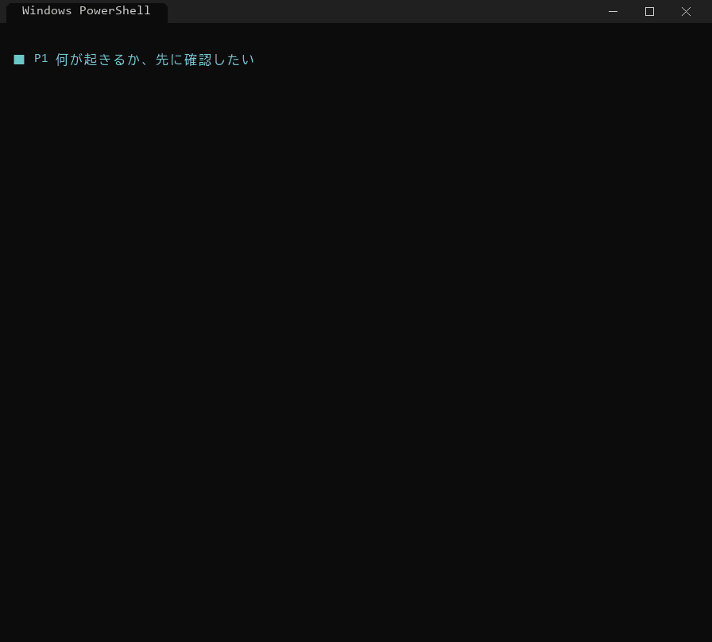
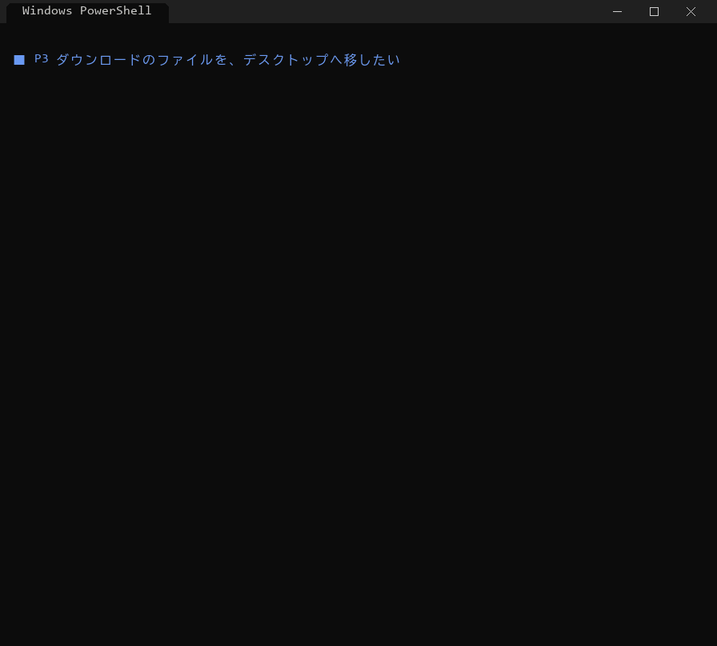

# FileMove
ファイルを移す際に複数ファイルを一度に移動させるソフトウェア

- フォルダの構成を保ったまま、たくさんのファイルを一度にコピー・移動できます
- コピー後に中身が同じか（SHA-256）を確かめてから完了とします。移動のときも、確かめるまで元のファイルは消しません
- 途中で止まっても、もう一度実行すれば続きから再開します
- 実行する前に「何がどこへ行くか」だけを確認できます（ドライラン）

画面で操作する **GUI** と、コマンドで使う **CLI** があります。できることは同じです。

| | GUI（画面） | CLI（コマンド） |
|---|---|---|
| 向いている人 | ふだんの整理に。ボタンで操作したい | 決まった作業をくり返したい・バッチで自動化したい |
| 起動 | `gui\FileMove.pyw` をダブルクリック、または `python -m gui` | `python migrate_files.py 移行元 移行先` |
| 対応 OS | Windows（Mac・Linux は今後対応予定） | Windows・Mac・Linux |
| マニュアル | [docs/gui/MANUAL.md](docs/gui/MANUAL.md) | [docs/cli/MANUAL.md](docs/cli/MANUAL.md) |

## GUI（画面で使う）

ダウンロードにたまったファイルを、デスクトップへ移して整理する例です。

**① 何が起きるか、先に確認する**（「確認（ドライラン）」。何も書き込まずに、どこへ行くかだけをログに表示）


**② 移動する**（方法で「移動」を選んで「実行」。移行先で中身の一致を確かめてから元を消す）


ほかの使い方（種類ごとの振り分け・重複の削除・ドライブ間の移動など）は [docs/gui/MANUAL.md](docs/gui/MANUAL.md#8-シナリオで見る使い方) にまとめています。

## CLI（コマンドで使う）

```
python migrate_files.py 移行元 [移行元 ...] 移行先 --dry-run   # まず確認
python migrate_files.py 移行元 [移行元 ...] 移行先             # 実行（--move で移動）
```

移行元にはフォルダ・ファイル・ワイルドカードを混ぜて複数指定できます。

**① 何が起きるか、先に確認する**（`--dry-run`）



**② 移動する**（`--move`。C ドライブ → D ドライブのようなドライブ間でも同じ）



ほかの使い方（コピー・振り分け・再開・コピー済みの片付け・重複の削除など）は [docs/cli/MANUAL.md](docs/cli/MANUAL.md#13-シナリオで見る使い方) にまとめています。

## 開発者向け

| やりたいこと | コマンド |
|---|---|
| テスト（本体・CLI・GUI・シナリオ） | `python -m pip install -r requirements-dev.txt` の後に `python -m pytest` |
| CLI のデモを動かす | `python demo/cli/demo.py`（`--auto` で止まらずに流す、`--only 3` で P3 だけ） |
| CLI のデモの GIF を作り直す | `python demo/cli/make_gif.py`（`docs/images/cli/` に出力。Pillow が必要） |
| GUI のデモを見る | `python demo/gui/demo_gui.py --show 2`（G2 を画面で再生） |
| GUI のデモの GIF を作り直す | `python demo/gui/demo_gui.py`（`docs/images/gui/` に出力。Windows・Pillow が必要。録画中は画面にウィンドウが出る） |

構成: 本体と CLI は `migrate_files.py`、GUI は `gui/`（本体の `run_migration()` を呼ぶだけ）。今後の予定は [plan.md](plan.md)。
