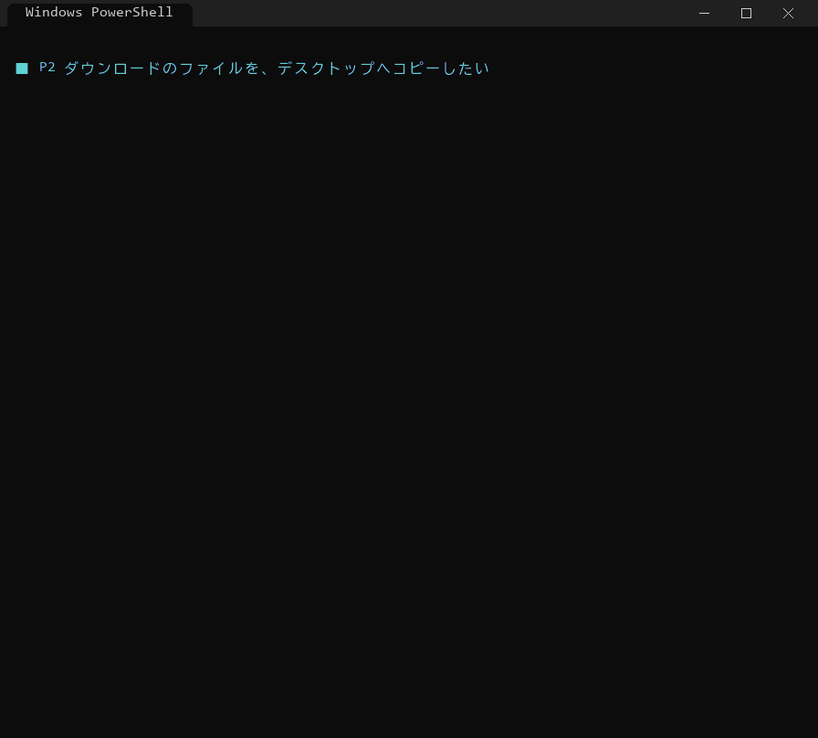

# FileMove
ファイルを移す際に複数ファイルを一度に移動させるソフトウェア


## 使い方

```
python migrate_files.py 移行元 [移行元 ...] 移行先 --dry-run   # まず確認
python migrate_files.py 移行元 [移行元 ...] 移行先             # 実行（--move で移動）
```

移行元にはフォルダ・ファイル・ワイルドカードを混ぜて複数指定できます。

## デモ

ダウンロードにたまったファイルを、デスクトップへ移して整理する例です。

**① 何が起きるか、先に確認する**（`--dry-run`。何も書き込まずに、どこへ行くかだけを表示）


**② コピーする**（コピー後に中身を SHA-256 で照合。ダウンロードのファイルは残る）



**③ 移動する**（`--move`。移行先で中身の一致を確かめてから元を消す。C ドライブ → D ドライブのようなドライブ間でも同じ）


ほかの使い方（種類ごとの振り分け・再開・コピー済みの片付け・重複の削除・ドライブ間の移動など）は [docs/MANUAL.md](docs/MANUAL.md#13-シナリオで見る使い方) にまとめています。

- 詳しい使い方: [docs/MANUAL.md](docs/MANUAL.md)
- デモ: `python demo/demo.py`（サンプルを作って 12 のパターンを順に実行します。`--auto` で止まらずに流す、`--only 3` で P3 だけ）
- デモの GIF を作り直す: `python demo/make_gif.py`（`docs/images/` に出力。Pillow が必要）
- 動作確認: `python -m pytest`（単体テストと全シナリオ。シナリオだけなら `python testdata/run_scenarios.py`）
