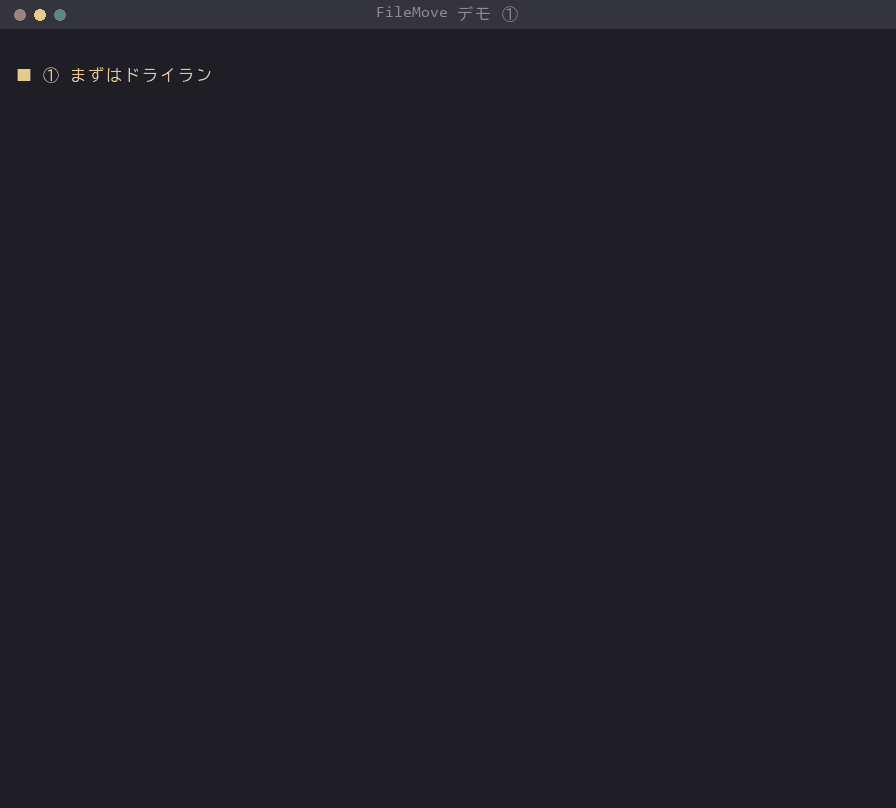
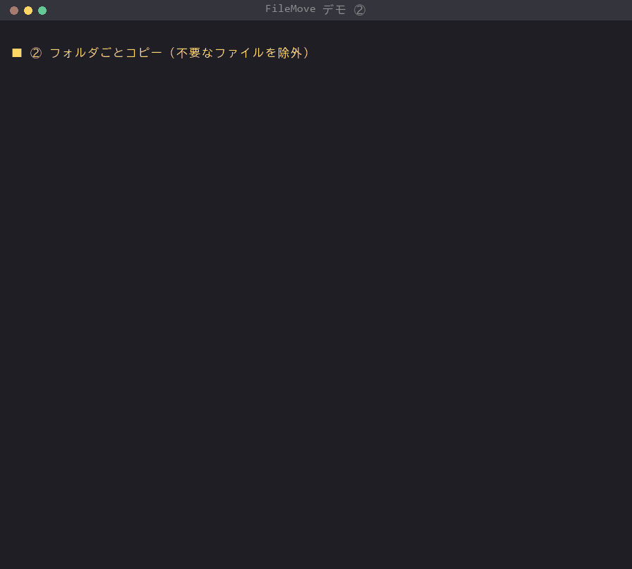
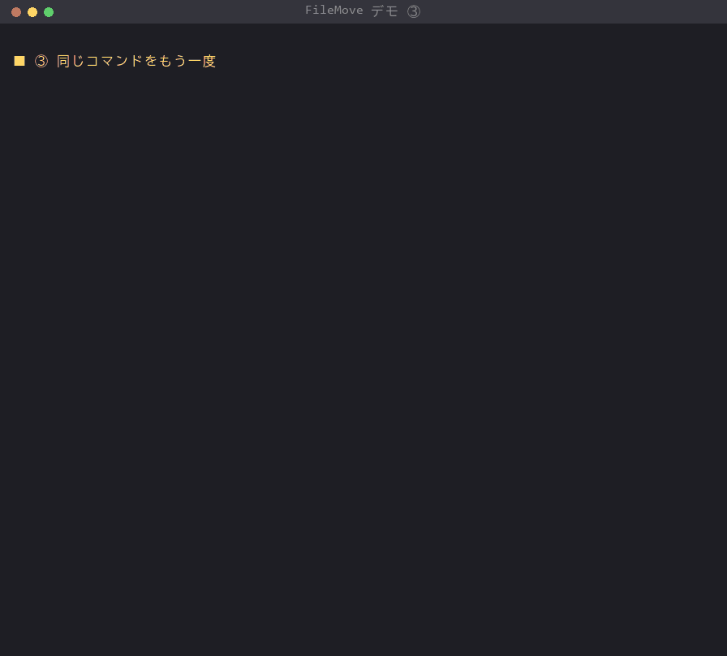
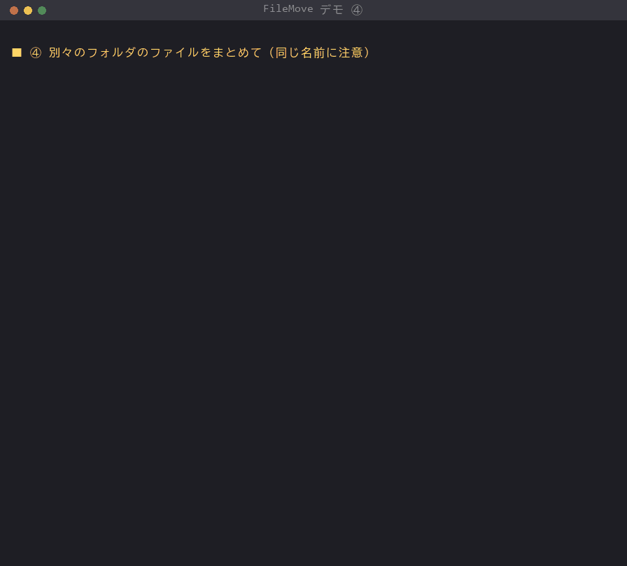
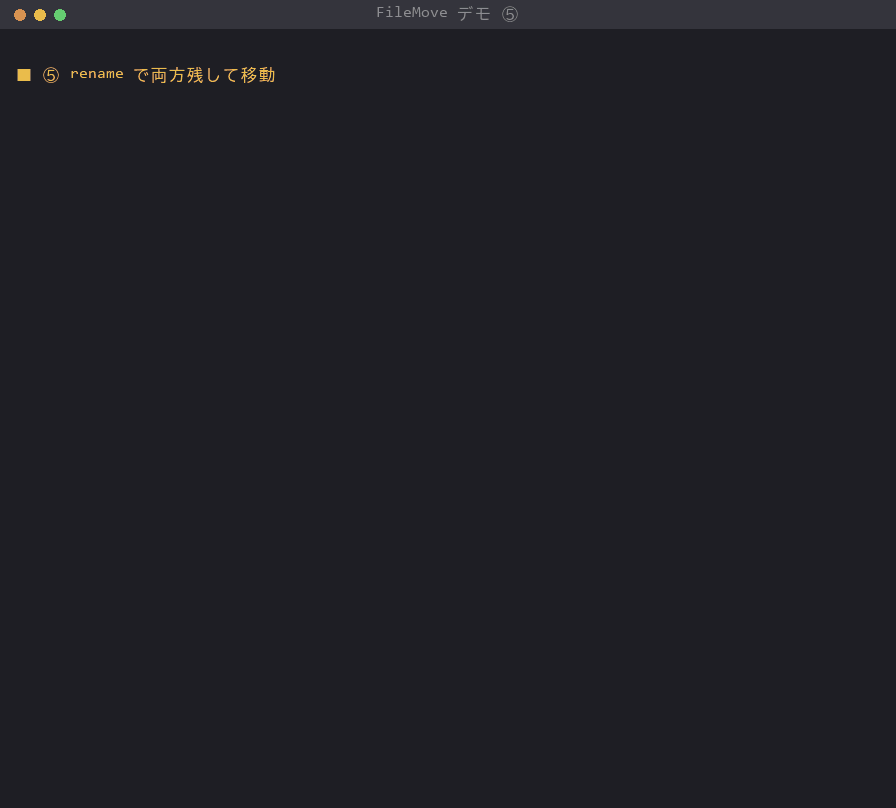
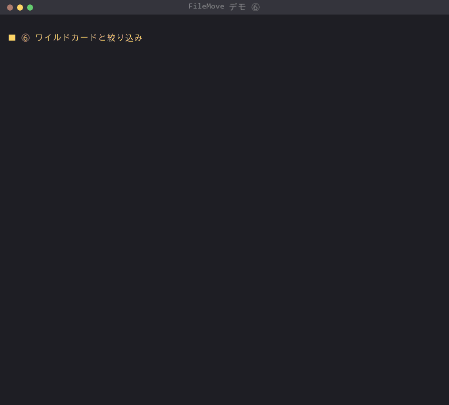
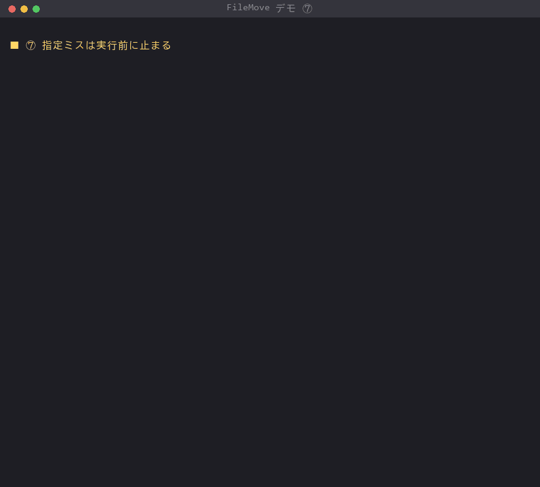
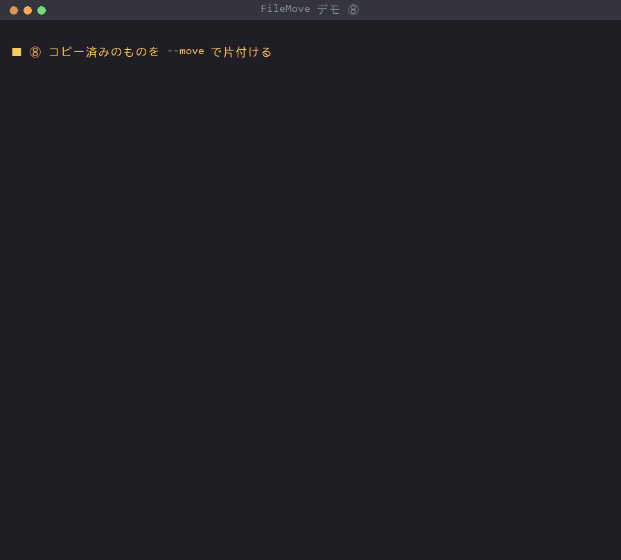
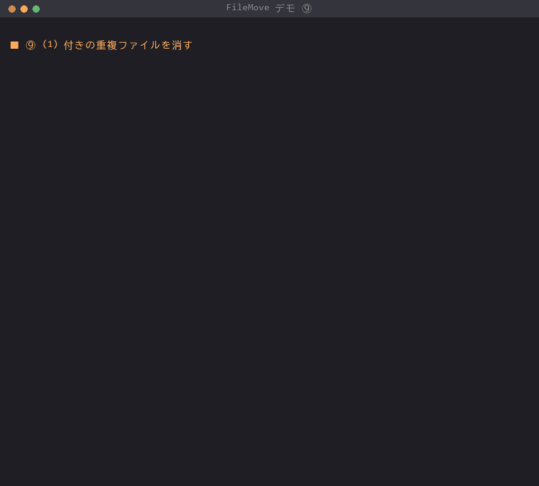

# FileMove 利用マニュアル

FileMove（`migrate_files.py`）は、たくさんのファイルを一度にコピー・移動するためのコマンドです。

- フォルダごと、ファイル 1 つ、別々のフォルダにある複数のファイル、どれでも指定できます
- コピー後に中身が同じか（SHA-256）を確認してから完了とします。移動のときも、確認できるまで元のファイルは消しません
- 途中で止まっても、同じコマンドをもう一度実行すれば続きから再開します
- 実際に動かす前に「何がどこへ行くか」だけを確認できます（ドライラン）

実際の画面は [13. シナリオで見る使い方](#13-シナリオで見る使い方) の GIF で確認できます。

---

## 1. 準備

- Python 3 が必要です（3.14 で動作確認済み）。追加のライブラリは不要です
- `migrate_files.py` を好きな場所に置くだけで使えます

確認:

```
python migrate_files.py --help
```

---

## 2. まずはこれだけ

```
python migrate_files.py 移行元 移行先 --dry-run   ← ① 何が起きるか確認（何も書き込まない）
python migrate_files.py 移行元 移行先             ← ② 実行（コピー）
```

**必ず ① のドライランで結果を見てから ② を実行してください。** 移動したいときは ② に `--move` を付けます。

---

## 3. 移行元の指定方法

最後に書いたものが**移行先フォルダ**、それより前はすべて**移行元**です。

| やりたいこと | 書き方 | 結果 |
|---|---|---|
| フォルダの中身をまるごと | `python migrate_files.py D:\old D:\new` | `D:\old` の中身が構成そのままで `D:\new` に入る |
| ファイル 1 つ | `python migrate_files.py D:\old\見積書.pdf D:\new` | `D:\new\見積書.pdf` |
| 別々のフォルダのファイルをまとめて | `python migrate_files.py D:\a\x.pdf E:\b\y.xlsx D:\new` | `D:\new\x.pdf`、`D:\new\y.xlsx` |
| ワイルドカード | `python migrate_files.py "D:\old\*.pdf" D:\new` | 一致したファイルすべて |
| 混在 | `python migrate_files.py D:\old\写真 D:\memo.txt D:\new` | 写真フォルダの中身と memo.txt |

- ファイルを指定した場合は、移行先フォルダの**直下**に同じ名前で置かれます
- ワイルドカード（`*`、`?`）は `"` で囲んでください。`**` を使うとサブフォルダもたどります（例: `"D:\old\**\*.pdf"`）
- 名前にスペースを含むパスも `"` で囲みます（例: `"D:\old\meeting notes.txt"`）
- 移行先フォルダが無ければ自動で作られます
- 移行元に**存在しないものが 1 つでもあると、何もせずに止まります**（どれが無いかが表示されます）
- 同じファイルを重ねて指定しても、処理されるのは 1 回だけです

---

## 4. コピーと移動

| | 指定 | 元のファイル |
|---|---|---|
| コピー（既定） | なし | 残る |
| 移動 | `--move` | 移行先で中身が一致したことを確認してから削除 |

- 更新日時などの情報も引き継がれます
- 移動しても、**元のフォルダ（空になったもの）は残ります**。不要なら手で削除してください
- 移行先に**同じ中身のファイルが既にある**ものは、転送せずに元のファイルだけ削除します（`_1` を付けた複製も作りません）。以前にコピーしておいたものを、後から `--move` で片付けることもできます
- 中身の確認（ハッシュ照合）を省略して速くしたい場合は `--no-verify`（おすすめしません）

---

## 5. 移行先に同じ名前のファイルがあるとき

`--on-exists` で選びます。

| 指定 | 動作 |
|---|---|
| `skip`（既定） | 何もしない。既存のファイルが残る。`--move` でも、中身が違えば元のファイルは消えない |
| `rename` | 番号を付けて両方残す（`報告書.pdf` → `報告書_1.pdf`、`_1` があれば `_2`…） |
| `overwrite` | 上書きする |

別々のフォルダから同じ名前のファイルを集めるときは、実行前に次のような警告が出ます。両方残したいなら `--on-exists rename` を付けてください。

```
移行先で同じ名前になるファイルが 1 組あります（--on-exists に従って処理。両方残すには --on-exists rename）
  report.txt <- D:\a\report.txt, D:\b\report.txt
```

---

## 6. 重複ファイルの削除

`--dedupe` を付けると、転送の後に移行先フォルダを調べ、`報告書 (1).pdf` のような番号付きのファイルが
同じフォルダの `報告書.pdf` と**同じ中身なら**番号付きの方を削除します。

- 中身が違うもの、番号なしの元ファイルが無いものは消しません
- `報告書(1).pdf`（空白なし）、`報告書（1）.pdf`（全角括弧）、`archive (1).tar.gz` も対象です
- `--dry-run` と一緒に使うと、消す予定のものが表示されるだけで何も消えません

```
重複を削除: docs/報告書 (1).pdf（報告書.pdf と同じ内容）
重複ファイルの削除: 1 件 / 20.0KB
```

---

## 7. 対象を絞り込む

| 指定 | 例 | 意味 |
|---|---|---|
| `--ext` | `--ext pdf,xlsx` | この拡張子だけ（大文字小文字は区別しない） |
| `--exclude` | `--exclude "*.tmp" --exclude Thumbs.db` | 一致するファイル・フォルダを除外（何回でも指定可） |
| `--since` | `--since 30d` / `--since 12h` / `--since 2026-04-01` | この日時以降に更新されたものだけ |
| `--min-size` | `--min-size 1KB` | このサイズ以上 |
| `--max-size` | `--max-size 500MB` | このサイズ以下 |

条件は組み合わせられます（すべて満たすものが対象）。ファイルを直接指定した場合も同じ条件で判定するので、条件に合わなければ「対象 0 件」になります。

よく使う除外の例（Office の一時ファイル、Windows のサムネイル、開発用フォルダ）:

```
--exclude "~$*" --exclude Thumbs.db --exclude "*.tmp" --exclude node_modules --exclude .git
```

---

## 8. 中断と再開

処理結果は 1 件ずつ**台帳**（既定は実行した場所の `migration_ledger.jsonl`）に記録されます。

- 途中で止まった・止めた（Ctrl+C）場合は、**同じコマンドをもう一度実行**すると、完了済みのものを飛ばして続きから再開します
- 失敗したファイルは、次回の実行で再挑戦します
- 台帳は「どこから・どこへ」の組み合わせごとに区別されるので、別の移行で同じ台帳を使っても混ざりません
- 最初からやり直したい場合は `--restart`

台帳が理由で飛ばしたファイルがあると、最後に件数が表示されます。

```
完了: 成功 0 / スキップ 24 / 失敗 0
  うち台帳で処理済みとしてスキップ 22 件（最初からやり直すには --restart）
```

---

## 9. 結果の見方

画面と同じ内容がログファイル（既定は `migration.log`）にも追記されます。

```
完了: 成功 22 / スキップ 2 / 失敗 0
転送量 4.6MB / 所要 0.3秒
```

| 項目 | 意味 |
|---|---|
| 成功 | コピー（移動）できた件数。ドライランでは「実行すれば転送される件数」 |
| スキップ | 移行先に同名があった、または台帳で処理済みだった件数（`--move` で移行先に同じ内容があり、元だけ削除したものも含む） |
| 失敗 | エラーになった件数。最後に `- 失敗: ファイル名: 理由` が並びます |

**終了コード**（バッチファイルなどから使う場合）

| コード | 意味 |
|---|---|
| 0 | すべて成功（スキップは成功扱い） |
| 1 | 失敗したファイルがある |
| 2 | 指定の誤り、または中断 |

---

## 10. オプション一覧

| オプション | 説明 | 既定 |
|---|---|---|
| `--dry-run` | 書き込まずに対象だけ表示 | |
| `--move` | 移動（確認後に元を削除） | コピー |
| `--dedupe` | 転送後、移行先の番号付き重複（`name (1).ext`）を削除 | しない |
| `--on-exists skip\|rename\|overwrite` | 同名ファイルがあるときの動作 | skip |
| `--no-verify` | ハッシュ照合を省略 | 照合する |
| `--ext` | 対象拡張子（カンマ区切り） | すべて |
| `--exclude` | 除外パターン（複数可） | なし |
| `--since` | 更新日時の下限 | なし |
| `--min-size` / `--max-size` | サイズの下限 / 上限 | なし |
| `--ledger パス` | 台帳ファイル | `migration_ledger.jsonl` |
| `--restart` | 台帳を無視して最初から | |
| `--log パス` | ログファイル | `migration.log` |
| `-v`, `--verbose` | 台帳で飛ばしたものも 1 件ずつ表示 | |

---

## 11. 困ったとき

| 症状 | 原因と対処 |
|---|---|
| 「移行元が見つかりません」 | パスの打ち間違い、またはワイルドカードに一致するものが無い。表示されたパスを確認 |
| 「移行元と移行先が同じです」 | 移行先に、移行元（ファイルの場合はそのファイルがあるフォルダ）と同じ場所を指定している |
| 「移行先がディレクトリではありません」 | 移行先にファイルを指定している。移行先はフォルダを指定する |
| 何もコピーされない（スキップばかり） | 以前に同じ移行を実行済み（台帳）か、移行先に同名ファイルがある。`-v` で理由を確認、やり直すなら `--restart` |
| 「対象 0 件」 | 絞り込み条件（`--ext` など）に合うファイルが無い |
| `*.pdf` が効かない | `"` で囲む（例: `"D:\old\*.pdf"`） |
| サイズ指定でエラー | 書き方は `500K`、`10MB`、`1.5GB` のように数字＋単位 |

---

## 12. 注意事項

- `--move`、`--dedupe`、`--on-exists overwrite` は元に戻せません。ドライランで確認してから実行してください
- 空のフォルダはコピーされません（ファイル単位で移行するため）
- 移行先が移行元フォルダの中にあっても、移行先の中はたどらないので無限にコピーされることはありません

---

## 13. シナリオで見る使い方

古い PC から新しい PC へデータを移す、という想定で、ひととおりの使い方を順に実行しています。
同じものは `python demo/demo.py` で手元でも動かせます（サンプルのフォルダを `demo/work/` に作って実行します）。

### 0. 移したいフォルダ

旧PC の「書類」「写真」と、デスクトップ・ダウンロードのファイルを新PC へ移します。
Office の一時ファイル（`~$…`）や `Thumbs.db`、同じ写真を 2 回保存した `旅行_01 (1).jpg` も混ざっています。


### 1. 何が起きるか、先に確認したい

`--dry-run` を付けると、何がどこへ行くかを表示するだけで、何も書き込みません。（→ [2. まずはこれだけ](#2-まずはこれだけ)）



### 2. いらないファイルを除いて、フォルダごとコピーしたい

`--exclude` で一時ファイルなどを除外します。フォルダの構成はそのまま、コピー後に中身を照合します。（→ [7. 対象を絞り込む](#7-対象を絞り込む)）



### 3. 途中で止まった・もう一度実行してしまった

台帳に記録されているので、済んだものは飛ばします。同じコマンドで続きから再開できます。（→ [8. 中断と再開](#8-中断と再開)）



### 4. あちこちのファイルを 1 か所に集めたい（同じ名前がある）

デスクトップとダウンロードの両方に `report.xlsx` があるので、実行前に警告が出ます。（→ [3. 移行元の指定方法](#3-移行元の指定方法)、[5. 移行先に同じ名前のファイルがあるとき](#5-移行先に同じ名前のファイルがあるとき)）



### 5. 両方残して、移動したい

`--on-exists rename` で番号を付けて両方残し、`--move` で移動します。（→ [4. コピーと移動](#4-コピーと移動)）



### 6. 最近の PDF だけ集めたい

ワイルドカードと `--ext`・`--since` を組み合わせます。（→ [7. 対象を絞り込む](#7-対象を絞り込む)）



### 7. パスを打ち間違えた

存在しないファイルが 1 つでもあると、何もせずに止まります。（→ [11. 困ったとき](#11-困ったとき)）



### 8. コピーしておいた元のフォルダを、後から片付けたい

同じコマンドに `--move` を付けると、移行先に同じ中身があるものは転送せずに元だけ消します。除外したファイルは残ります。（→ [4. コピーと移動](#4-コピーと移動)）



### 9. `(1)` 付きの重複ファイルを消したい

`--dedupe` で、移行先の `旅行_01 (1).jpg` のうち `旅行_01.jpg` と同じ中身のものを消します。まずドライランで確認します。（→ [6. 重複ファイルの削除](#6-重複ファイルの削除)）


