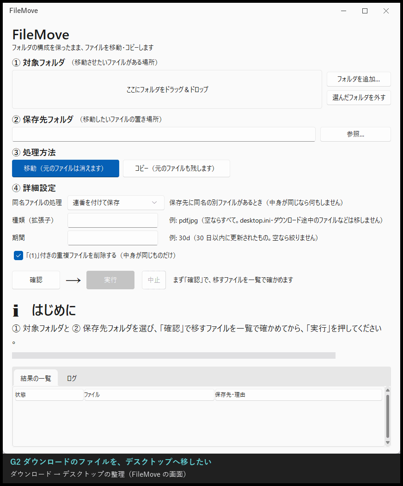
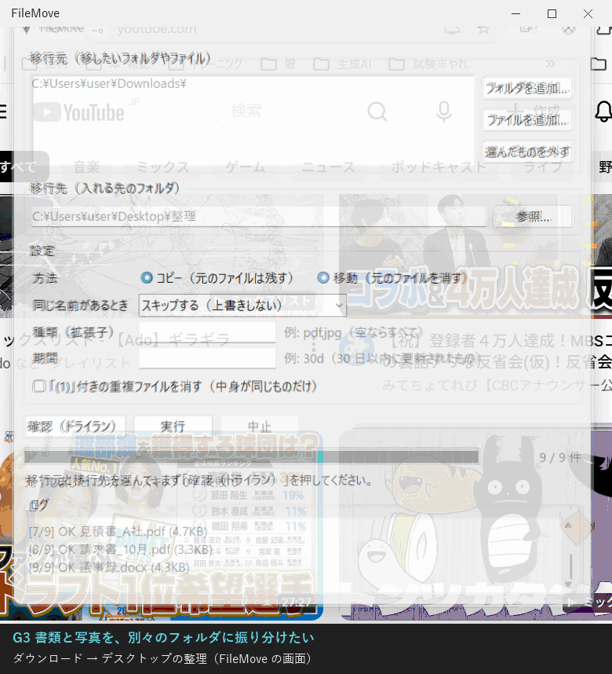
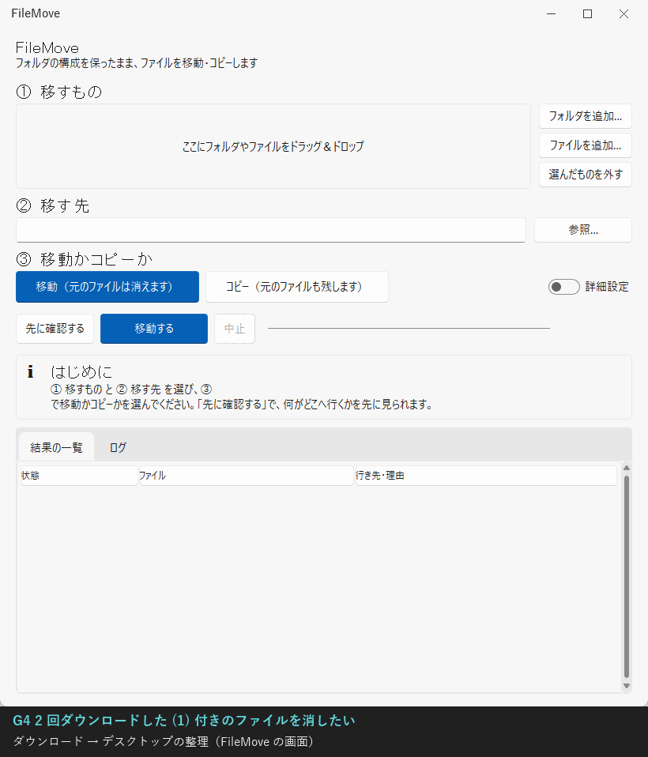
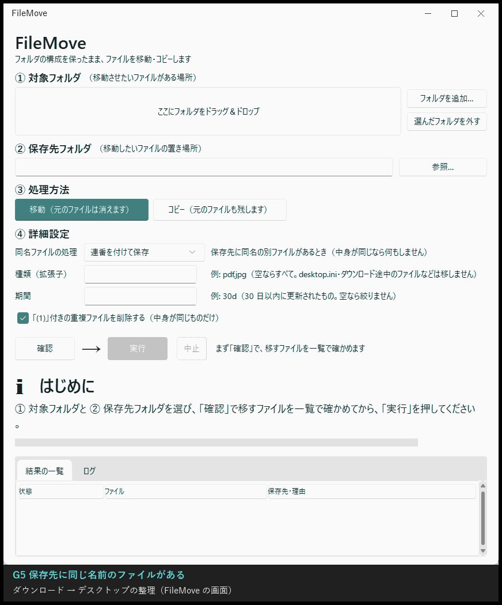
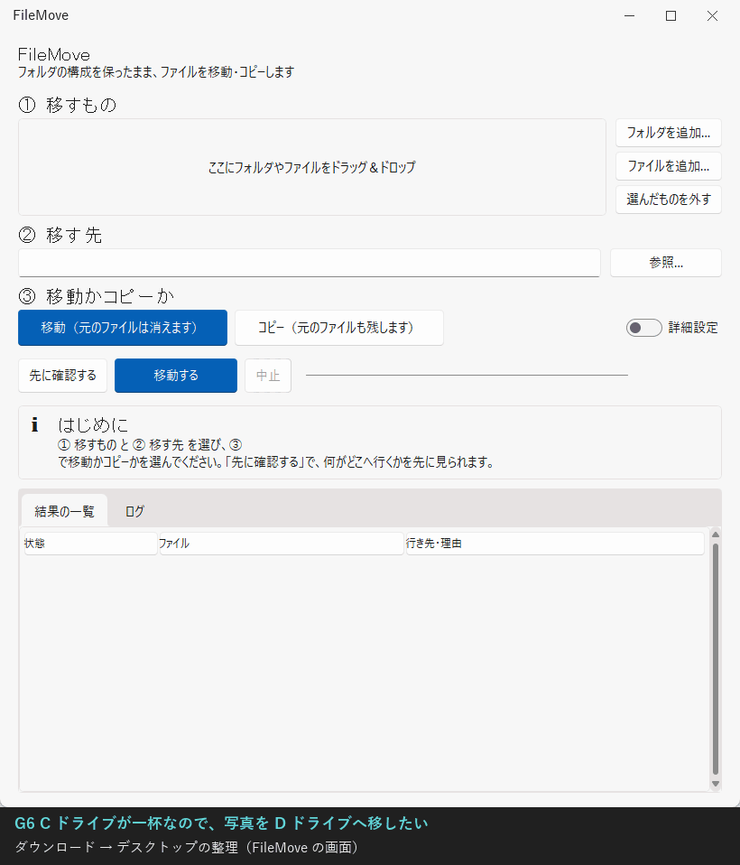

# FileMove 利用マニュアル（GUI・画面で使う）

FileMove は、たくさんのファイルを一度にコピー・移動するためのソフトです。この画面版では、フォルダを選んでボタンを押すだけで使えます。

- コピー後に中身が同じか（SHA-256）を確かめてから完了とします。移動のときも、確かめるまで元のファイルは消しません
- 途中で止めても、もう一度「実行」を押せば続きから再開します
- 実際に動かす前に「何がどこへ行くか」だけを確認できます（確認（ドライラン））

コマンドで使いたい場合や、画面に無い細かい設定を使いたい場合は [CLI のマニュアル](../cli/MANUAL.md) を見てください。

実際の操作は [8. シナリオで見る使い方](#8-シナリオで見る使い方) の GIF で確認できます。

---

## 1. 起動

- Python 3 が必要です（3.14 で動作確認済み）。Windows の Python には画面の部品（tkinter）が最初から入っています
- 今のところ Windows 向けです（Mac・Linux は今後対応予定）

| 方法 | 手順 |
|---|---|
| ダブルクリック | `gui\FileMove.pyw` をダブルクリック（黒い画面は出ません） |
| コマンド | FileMove のフォルダで `python -m gui` |

---

## 2. 画面の見方


| 場所 | すること |
|---|---|
| 移行元 | 「フォルダを追加…」「ファイルを追加…」で、移したいものを選びます。いくつでも追加できます。間違えたら一覧で選んで「選んだものを外す」 |
| 移行先 | 「参照…」で、入れる先のフォルダを選びます（直接入力も可）。無ければ自動で作られます |
| 設定 | 方法（コピー／移動）、同じ名前があるとき、種類（拡張子）、期間、重複ファイルの削除（→ [4. 設定](#4-設定)） |
| ボタン | 「確認（ドライラン）」「実行」「中止」 |
| 進捗 | 進捗バーと「3 / 9 件」の件数、その下に今の状態や結果 |
| ログ | 1 件ずつの結果（どこへ行ったか、スキップした理由、エラー） |

- フォルダを選ぶと、中身がフォルダの構成そのままで移行先に入ります
- ファイルを選ぶと、移行先フォルダの**直下**に同じ名前で入ります

---

## 3. 基本の流れ

1. 「フォルダを追加…」で移行元を選ぶ（例: `C:\Users\あなた\Downloads`）
2. 「参照…」で移行先を選ぶ（例: `C:\Users\あなた\Desktop\整理`）
3. 方法を選ぶ（コピー／移動）
4. **「確認（ドライラン）」を押して、ログで行き先を確かめる**（まだ何も書き込みません）
5. よければ「実行」を押す。移動のときは確認の画面が出るので「はい」

---

## 4. 設定

| 設定 | 選べるもの | 説明 |
|---|---|---|
| 方法 | コピー（元のファイルは残す）／移動（元のファイルを消す） | 移動は、移行先で中身が同じと確かめてから元を消します。移行先に同じ中身のファイルが既にあるものは、転送せずに元だけ消します（前にコピーしたものを後から片付けられる） |
| 同じ名前があるとき | スキップする（上書きしない）／番号を付けて両方残す／上書きする | 「番号を付けて」なら `報告書_1.pdf` のように両方残します |
| 種類（拡張子） | 例: `pdf,jpg` | その種類だけを対象にします（大文字小文字は区別しない）。空ならすべて |
| 期間 | 例: `30d`（30 日以内）、`12h`（12 時間以内）、`2026-04-01`（その日以降） | 更新日時で絞ります。空なら絞りません |
| 「(1)」付きの重複ファイルを消す | チェック | 実行の後、今回ファイルを置いたフォルダで、`IMG_0001 (1).jpg` のような番号付きのファイルが `IMG_0001.jpg` と**中身も同じなら**消します。中身が違うもの、元のファイルが無いものは消しません |

画面に無い設定（除外するファイル、サイズでの絞り込み、照合の省略、台帳を無視したやり直しなど）は CLI で使えます（→ [CLI のマニュアル](../cli/MANUAL.md#10-オプション一覧)）。

---

## 5. 中止と再開

- 実行中に「中止」を押すと、今のファイルが終わったところで止まります。途中まで書いたファイルは残りません
- もう一度「実行」を押すと、済んだものは飛ばして続きから再開します
- 済んだものの記録（台帳）は `%LOCALAPPDATA%\FileMove\migration_ledger.jsonl` にあります。「どこから・どこへ」の組み合わせごとに区別されます
- 台帳で済になっていても、移行先からそのファイルが消えていれば、もう一度転送します

---

## 6. 結果の見方

実行が終わると、進捗バーの下に結果が出ます。

```
完了しました: 成功 9 / スキップ 0 / 失敗 0（重複を削除 1）
```

| 項目 | 意味 |
|---|---|
| 成功 | コピー（移動）できた件数。確認（ドライラン）では「実行すれば転送される件数」 |
| スキップ | 移行先に同じ名前があった、済んでいた、または移動で元だけ消した件数 |
| 失敗 | エラーになった件数。ログに理由が出ます。もう一度「実行」すると失敗したものだけ再挑戦します |
| 元だけ削除 | 移動で、移行先に同じ中身が既にあったので元だけ消した件数 |
| 重複を削除 | 「(1)」付きの重複として消した件数 |

---

## 7. 困ったとき

| 表示 | 原因と対処 |
|---|---|
| ⚠ 移行元を追加してください | 移行元が空です。「フォルダを追加…」か「ファイルを追加…」で選んでください |
| ⚠ 移行先のフォルダを選んでください | 移行先が空です |
| ⚠ 移行元が見つかりません | 追加した後に、そのフォルダやファイルが移動・削除されました。「選んだものを外す」で外してください |
| ⚠ 移行元と移行先が同じです | 移行先に、移行元（ファイルの場合はそのファイルがあるフォルダ）と同じ場所を選んでいます |
| ⚠ 移行先がディレクトリではありません | 移行先にファイルを入力しています。フォルダを選んでください |
| ⚠ 期間の書式が不正です | 期間の書き方が違います。`30d`、`12h`、`2026-04-01` のように入力してください |
| 何もコピーされない（スキップばかり） | 前に同じ移行を実行済みか、移行先に同じ名前のファイルがあります。ログで理由を確認してください |

**注意**
- 移動、「上書きする」、重複ファイルの削除は元に戻せません。先に「確認（ドライラン）」で確かめてください
- 移動しても、空になった元のフォルダは残ります
- 空のフォルダはコピーされません（ファイル単位で移すため）

---

## 8. シナリオで見る使い方

CLI のマニュアルと同じ「ダウンロードにたまったファイルを、デスクトップへ移して整理する」場面です。
ファイルを選ぶ画面は自動で操作できないため、GIF では「フォルダを追加…」などのボタンを指した後に、選んだ結果が入った状態にしています。
同じものは `python demo/gui/demo_gui.py --show 2`（G2 を画面で再生）で手元でも動かせます。

### G1. 何が起きるか、先に確認したい

移行元と移行先を選んで「確認（ドライラン）」を押すと、どのファイルがどこへ行くかがログに出ます。まだ何も書き込みません。


### G2. ダウンロードのファイルを、デスクトップへ移したい

方法で「移動」を選んで「実行」を押します。進捗バーが進み、終わると結果が出ます。



### G3. 書類と写真を、別々のフォルダに振り分けたい

種類（拡張子）に `pdf,docx,xlsx,txt` を入れて `Desktop\書類` へ、続けて `jpg` に変えて `Desktop\写真` へ移します。



### G4. 2 回ダウンロードした (1) 付きのファイルを消したい

「(1) 付きの重複ファイルを消す」にチェックを入れて実行すると、`IMG_0001 (1).jpg` のように中身も同じものが消えます。



### G5. 移行先に同じ名前のファイルがある

既定では上書きせずにスキップします。「同じ名前があるとき」を「番号を付けて両方残す」に変えると、`メモ_1.txt` として両方残ります。



### G6. C ドライブが一杯なので、写真を D ドライブへ移したい

移行先に D ドライブのフォルダを選ぶだけです。USB メモリや外付け HDD も同じです。


